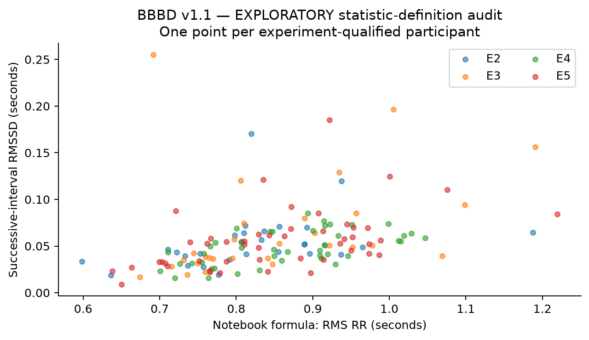

# ECG, R-peaks and HRV semantics

**Gate follow-up — 2026-10-02:** All 1,140 testable raw/filtered pairs favor causal fifth-order 0.5–25 Hz at design fs 2048 and near-unit gain; ten all-NaN raw files remain untestable. Absolute units and manual peak history remain open; the earlier RR/RMSSD findings stand. [Evidence and verdict](gate_closure.md).

**EMPIRICALLY VERIFIED IN THIS AUDIT.** R-peak files have a `timestamp` header and fractional stimulus-relative seconds; RR magnitudes and corresponding waveform extrema support that interpretation. Native detection timestamps are not restricted to the 128 Hz waveform grid.

| experiment | files | people | peak_count | duplicates | nonmonotonic | median_file_HR_bpm | median_RMS_RR_seconds | median_RMSSD_seconds | max_broad_RR_failure_fraction |
| --- | --- | --- | --- | --- | --- | --- | --- | --- | --- |
| 2 | 283 | 29 | 86486 | 0 | 0 | 74.562 | 0.816 | 0.048 | 0.002 |
| 3 | 321 | 29 | 120122 | 0 | 0 | 72.816 | 0.832 | 0.043 | 0.006 |
| 4 | 258 | 43 | 81464 | 0 | 0 | 69.541 | 0.862 | 0.045 | 0.008 |
| 5 | 288 | 48 | 107989 | 0 | 0 | 71.172 | 0.849 | 0.049 | 0.003 |

Timestamp order, duplicate/nonmonotonic peaks, broad RR bounds (0.3–2 s), author-range bounds (40–160 bpm), waveform bounds and local ±100 ms extrema were checked. Per-record peak failures are retained in [peak_qc.parquet](evidence/peak_qc.parquet). Local extrema agreement is a waveform/peak consistency diagnostic; a median offset of zero on a sampled ECG is not device synchronization accuracy or independently adjudicated detection sensitivity.

**Boundary exceptions:** five final R-peaks fall 0.00127–0.00649 seconds beyond their released filtered-waveform exclusive end, all less than one 128 Hz sample. The [exact exception ledger](evidence/rpeak_boundary_exceptions.csv) retains the timestamps and durations. This is compatible with export-grid quantization, but it is not independent proof of the native-clock transformation. No peaks were moved or removed. Median absolute local-extremum offset across files has overall median 0 and maximum file median 0.0234375 seconds; this supports local temporal correspondence rather than adjudicated detector accuracy.

**Metric definition resolved:** notebook `sqrt(mean(diff(peak_times)**2))` computes RMS RR. Successive-RR RMSSD is `sqrt(mean(diff(diff(peak_times))**2))`. Both were computed from the same released timestamps without changing supplied peaks. [Person/session comparison](evidence/hrv_person_session_comparison.csv) averages file metrics like the notebook; experiment4 combines attentive blocks only when explicitly described. The manuscript's executed input/version and exact Figure 6 numerical reproduction remain open; the mathematical definition mismatch is now demonstrated with actual release inputs.

No silent peak correction, ectopic removal, clinical interpretation or replacement of upstream HR values was made. RMS RR largely reflects mean interval and cannot be treated as beat-to-beat variability. A valid future HRV analysis must define beat editing, finite intervals, duration eligibility, units and the chosen metric.
