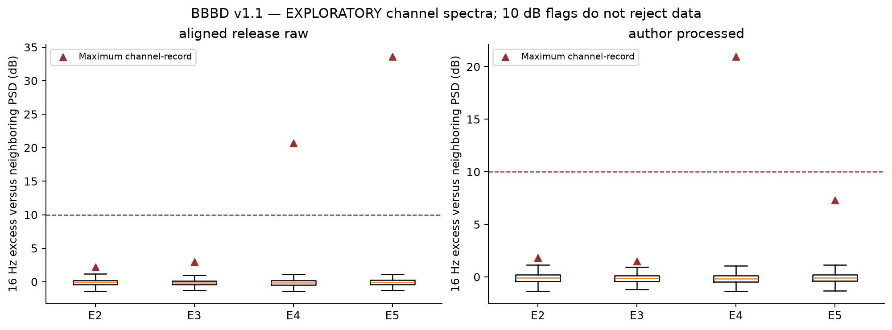
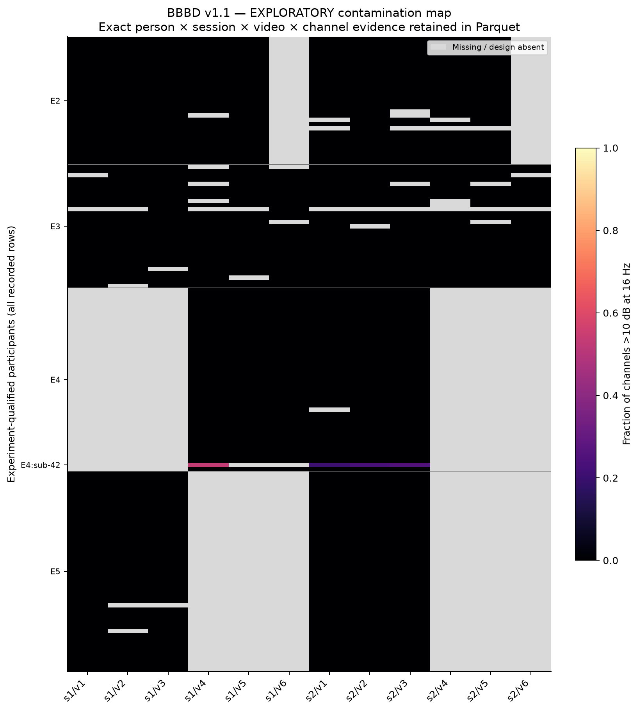
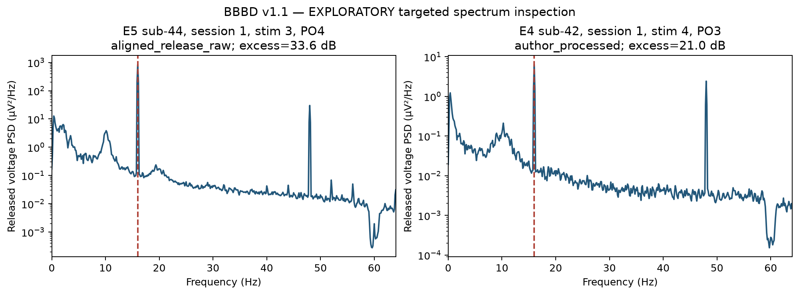

# EEG quality and 16 Hz characterization

**EMPIRICALLY VERIFIED IN THIS AUDIT.** The full channel map is [eeg_contamination_map.parquet](evidence/eeg_contamination_map.parquet): experiment × participant × session × canonical video × channel × raw/processed status. Every analyzed BDF has 64 exported channels at 128 Hz; labels/units are read from the binary header. Sidecars' fixed `RecordingDuration=0.5` contradict actual minutes-long recordings and are not used as duration evidence.

| experiment | status | channels | flagged_10dB | max_excess_dB | median_excess_dB | extreme_variance_flags | line_60Hz_flags | flag_fraction | flagged_people | flagged_recordings | max_16Hz_power_fraction |
| --- | --- | --- | --- | --- | --- | --- | --- | --- | --- | --- | --- |
| 2 | aligned_release_raw | 18624 | 0 | 2.149 | -0.105 | 14 | 0 | 0.000 | 0.000 | 0.000 | 0.030 |
| 2 | author_processed | 18624 | 0 | 1.842 | -0.101 | 0 | 2 | 0.000 | 0.000 | 0.000 | 0.033 |
| 3 | aligned_release_raw | 21248 | 0 | 2.968 | -0.149 | 137 | 0 | 0.000 | 0.000 | 0.000 | 0.021 |
| 3 | author_processed | 20608 | 0 | 1.499 | -0.136 | 0 | 0 | 0.000 | 0.000 | 0.000 | 0.019 |
| 4 | aligned_release_raw | 16384 | 81 | 20.658 | -0.125 | 72 | 0 | 0.005 | 1.000 | 4.000 | 0.414 |
| 4 | author_processed | 16320 | 78 | 20.971 | -0.152 | 0 | 0 | 0.005 | 1.000 | 4.000 | 0.463 |
| 5 | aligned_release_raw | 17856 | 6 | 33.626 | -0.074 | 59 | 0 | 0.000 | 1.000 | 6.000 | 0.881 |
| 5 | author_processed | 17856 | 0 | 7.293 | -0.089 | 0 | 0 | 0.000 | 0.000 | 0.000 | 0.092 |

PSD uses 8-second Hann/Welch segments (0.125 Hz bins) inside bounded chunks, with segment-count weighting. 16 Hz excess is 10log10(mean PSD15.75–16.25 / mean PSD14.5–15.5 and16.5–17.5). Sensitivity flags at 3/6/10/20 dB, fraction of 0.5–45 Hz power at the peak, 60 Hz excess and band powers are retained. A >10 dB peak is a screening flag, not proof of instrumental origin. The authors' instrument warning is an **AUTHOR-REPORTED LIMITATION**; measured peak magnitudes are **EMPIRICALLY VERIFIED IN THIS AUDIT**. Negative and unaffected recordings remain in the map.

[Target selection ledger](evidence/targeted_inspection_ledger.json) chooses the greatest excess in each representation without using quiz outcomes. Exp.5 raw peaks can be strong while processed counterparts lack a >10 dB narrow peak; this does not prove the exact cleaning operation or its neural-information consequences. A 48 Hz peak is also visible in both targeted spectra; its possible relation to the third harmonic of 16 Hz is **OUR INFERENCE**, not source attribution. The 48 Hz magnitude was not quantified dataset-wide in this pass. Exp.4 residual peaks require recording/channel-specific sensitivity analysis. Do not reject an experiment or interpret beta-band/coupling content automatically from these flags.

Extreme variance flags are a descriptive >100 ratio to the record's median channel variance. Flatness and band anomalies should guide additional artifact assessment and alternative preprocessing once provenance is resolved. No re-referencing, filtering, rejection or source modification was performed.
