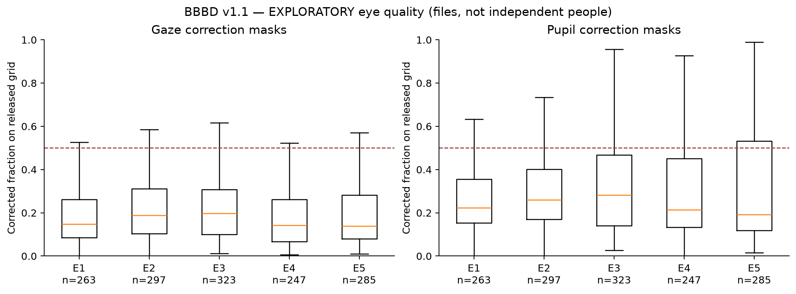

# Eye and pupil quality

**Gate follow-up — 2026-10-02:** Exporter column selection and 17 pupil probes exclude a simple 95th-percentile-normalized output interpretation. Head-regression history, buffers and kernels remain open; differences outside masks are not proof of unmarked native artifacts. [Evidence and verdict](gate_closure.md).

**EMPIRICALLY VERIFIED IN THIS AUDIT.** Both raw and processed continuous eye files in this release are gzip-compressed and headerless. Correction interval files have `start_time/end_time` headers in seconds. Original masks remain first-class evidence, alongside conservative floor/ceil mapping to the 128 Hz released grid. No masks were replaced by a smooth signal's apparent completeness.

| experiment | modality | files | mean_correction | median_correction | max_correction | max_gap_seconds | basic_QC_flags |
| --- | --- | --- | --- | --- | --- | --- | --- |
| 1 | gaze | 263 | 0.217 | 0.148 | 0.904 | 189.219 | 35 |
| 1 | pupil | 263 | 0.307 | 0.224 | 0.995 | 144.039 | 39 |
| 2 | gaze | 297 | 0.241 | 0.189 | 0.910 | 122.742 | 33 |
| 2 | pupil | 297 | 0.344 | 0.260 | 0.987 | 100.633 | 60 |
| 3 | gaze | 323 | 0.235 | 0.198 | 0.872 | 173.688 | 42 |
| 3 | pupil | 323 | 0.368 | 0.281 | 0.987 | 174.477 | 75 |
| 4 | gaze | 247 | 0.193 | 0.143 | 0.882 | 229.836 | 17 |
| 4 | pupil | 247 | 0.337 | 0.213 | 0.980 | 230.469 | 56 |
| 5 | gaze | 285 | 0.205 | 0.138 | 0.932 | 108.508 | 28 |
| 5 | pupil | 285 | 0.354 | 0.192 | 0.988 | 108.695 | 72 |

Masks are unioned with nonfinite samples, nonpositive pupil values and off-screen gaze coordinates (1920×1080) for provisional validity. Off-screen gaze may include meaningful looking-away behavior, so this is a measurement eligibility flag, not an inattentive label. Reported correction gaps include grid quantization of at most approximately two samples per interval; exact original intervals are retained for alternative rules.

[Condition/video summaries](evidence/eye_quality_by_condition_video.csv); [missingness map](evidence/missingness_map.parquet). Masks encode upstream correction intentions; absent originals/native logs prevent independently proving that every interpolated sample or every bad observation was marked. Missing processed files are distinct from a large correction burden in an existing file. Whole-file pupil IQR/variation cannot automatically be called dilation; head-regression and normalization provenance remain unresolved for exported variants.
