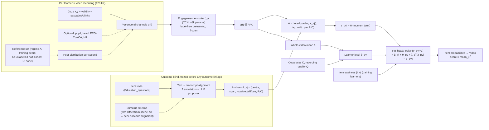

# Research plan — CAIRN: a content-anchored item-response model of moment-to-moment engagement for video learning

**Version 1.1, 2026-10-08.** v1.0 was drafted and then revised after the [skeptical review](critical_review.md); revision tags **[R1]–[R15]** mark the changes.

**Amendment v1.2, 2026-10-13 (Stage 0).** The outcome-free Stage-0 evidence ([stage0/](stage0/README.md)) required the changes below. Tags **[S0-1]–[S0-8]** mark them in the text. Everything else in v1.1 stands. The v1.1 text is kept where amended, so the history stays visible.

| Tag | Change | Evidence |
|---|---|---|
| [S0-1] | **Novelty narrowed.** "First content-anchored item-level prediction" is withdrawn: Lallé et al. 2025 already predict per-item retention from gaze in content-tied windows, for held-out learners. N-a becomes N-a′ (psychometric identification). **N-d (falsification) becomes the central claim**. N-b loses the peer-free variant | [literature_closeout.md](stage0/literature_closeout.md) |
| [S0-2] | **Timelines recovered.** 10/11 videos pass G-TL (Immune PARTIAL). Enzymes is two concatenated eHow videos. A substitute replication criterion applies to the three single-experiment videos | [timeline_audit.md](stage0/timeline_audit.md) |
| [S0-3] | **Modalities.** Gaze alignment, dynamics and validity are primary; pupil is ablation only; head, EEG and ECG are diagnostic only (EEG fails the Stage-0 reliability check) | [signal_feasibility.md §8](stage0/signal_feasibility.md#8-modality-decisions-for-stage-1) |
| [S0-4] | **CAIRN-linear is the pre-specified primary candidate**; the learned encoder is ablation A4 [R4]. Regime B (reference distillation) is dropped | idem §6 |
| [S0-5] | **New baseline B9:** Lallé-style pooled window classifier | Literature close-out |
| [S0-6] | **Anchoring.** Provisional machine anchors (105/131; development 87/107; 59 distinct development moments). G-AN awaits human annotators. T2 permutes distinct anchor moments | [anchor_audit.md](stage0/anchor_audit.md) |
| [S0-7] | **Power inputs corrected** (§20.3): the locked primary cohort has about 26 anchorable items (about 19 moments), not 36. The Stage-1 simulation re-derives δ_item and locked power, with a declared redesign path | [stage1_spec.md §1](stage0/stage1_spec.md) |
| [S0-8] | **NH4** uses long (≥ 1 s) invalid episodes | Signal feasibility §3 |

**Amendment v1.3, 2026-10-14 (Stage 1).** The outcome-free Stage-1 implementation and design simulation ([stage1/](stage1/README.md)) required the changes below. Tags **[S1-1]–[S1-13]** mark them in the text. Earlier text is kept where amended. Change [S1-9] **needs a user decision**, and [S1-11] and [S1-13] are **open items** to close before preregistration; everything else is in force.

| Tag | Change | Evidence |
|---|---|---|
| [S1-1] | **Primary form: within-recording detrended CAIRN-linear.** Each recording's per-second channels lose their linear trend before anchored pooling. The plan-literal form fails calibration under the fatigue/position confound (T1/T2 .085–.10) | [S1-D06](stage1/decisions.md); [simulation_report §1](stage1/simulation_report.md) |
| [S1-2] | **Identification explicit:** the moment regressor is centred within learner × video *and* within item (training-fold means) | S1-D03 |
| [S1-3] | **Estimation:** fixed ridges; variance components from the IRT-M2 base of each fold, held fixed across models and permutation refits; marginal prediction expit(η/√(1 + c²τ²)), c = 16√3/(15π), replacing the mixed probit/logit formula | S1-D04 |
| [S1-4] | **One λ shared across R/C**, six channels. λ_c is descriptive: E4 has three anchorable comprehension items | S1-D07 |
| [S1-5] | **Kernel:** hard anchor span. The lag/width grid (12 configurations) is a development selection | S1-D11 |
| [S1-6] | Reserved-descriptive set: **24** learners, not 26 | S1-D10 |
| [S1-7] | **§20.3 power superseded by simulation.** NH1 MDE (OR per SD of latent state, ρ = .4): E4 1.72; pooled E4 + E5 1.48 (CV) / 1.43 (LR); development 1.49. Clustering does not inflate λ's variance (ratio ≤ 1.03); estimating the moment direction does | [simulation_report §3, §6](stage1/simulation_report.md) |
| [S1-8] | **Minimum useful effect unchanged** (S_item ≥ .01 and ΔAUC_wp ≥ .02). It corresponds to OR ≈ 2.1–2.2 at ρ = .4, above plausible effects (1.15–1.5). δ_item (spec §1.7(3)) = OR 1.49 is the minimum *detectable* development effect, not a usefulness threshold | S1-D14 |
| [S1-9] | **Locked design (needs user decision):** pooled E4 + E5 lock, NH1 confirmatory, NH2–NH5 descriptive. **Ready now with the plan's CV statistic:** MDE 1.48, power .51 at OR 1.35; passes all nulls including non-linear fatigue. Upgrade with a likelihood-ratio statistic: MDE 1.43, power .66; needs approval plus a non-linear trend control (its single tests reach .08 under non-linear fatigue). No admissible design reaches .80 at OR 1.35 | S1-D15 |
| [S1-10] | **N-d scope:** the randomization nulls falsify content-timing against learner- and item-level structure; temporal trends are handled by the within-recording trend control, which is part of the method | S1-D17 |
| [S1-11] | **NH4 attribution (needs specification):** gaze-only channels reject in 15–26% of content-timed-loss nulls. A gaze test conditional on in-window validity must be specified and simulated before any "behaviour beyond data loss" claim | S1-D16 |
| [S1-12] | **Stop rule unchanged**; calibrated (false go ≤ .008). Go reaches 80% at OR ≈ 2.0, close to the useful threshold | S1-D13 |
| [S1-13] | **Open: non-linear temporal control.** Under a non-linear fatigue null, linear detrending leaves single tests at .072–.082 (intersections ≤ .068). A non-linear within-recording control (for example quadratic detrending) must be specified and simulated before the LR upgrade of [S1-9], and is advisable for every design | Rule R-E; [simulation_report §2, §5](stage1/simulation_report.md) |

**Amendment v1.4, 2026-10-15 (closure phase).** The outcome-free closure phase ([closure/](closure/README.md)) resolved the Stage-1 open items and fixed the confirmatory design. Rules were declared before the runs ([closure/evidence/predeclared_rules.md](closure/evidence/predeclared_rules.md), `591913ad…`). Tags **[C-1]–[C-12]** mark the changes. Earlier text is kept where amended. **[C-3] needs the user's ratification at the freeze**; everything else is in force.

| Tag | Change | Evidence |
|---|---|---|
| [C-1] | **Temporal control: cubic within-recording detrend (d = 3)** replaces the linear one ([S1-1], [S1-13]). Rule R-F, 60 decisive cells × 1,000 replicates: • linear: 11 cells > .07, up to .135; • quadratic: one cell, .074, under the out-of-family cubic null; • cubic: none (maximum .066). Pooled power cost at OR 1.5: .01–.05 | C-D13 |
| [C-2] | **Estimand made explicit:** the moment effect is the effect of the anchored engagement's deviation from the learner's own cubic engagement course over the recording | C-D03 |
| [C-3] | **Confirmatory design (decision D110; needs the user's ratification at the freeze):** • pooled E4 + E5 lock; • NH1 = T1 ∧ T2 on the **likelihood-ratio** statistic, B = 999; • **closed testing** of E4 and E5; • NH2–NH5 descriptive. The CV statistic is the certified fallback. [S1-9] is resolved | C-D04, C-D06, C-D15; [design_config.json](closure/design_config.json) |
| [C-4] | **Moment block: P6** (six channels, isotropic ridge 100) kept after rule R-G compared: • the unit-weighted composite (P0); • an anisotropic ridge (PT); • the frozen development direction (PD); • the adaptive min-p (PA). All are calibrated. The higher-mean candidates fail the declared robustness constraint across truth directions | C-D14 |
| [C-5] | **Calibration of the final design** (independent run, 1,000 replicates per null; N0–N3, N1q, N1c, N1e): • pooled LR tests ≤ .068; • E4 / E5 elementary NH1lr ≤ .043; • CV fallback ≤ .065; • 2PL and guessing nulls ≤ .056 | C-D15 |
| [C-6] | **Power** (ρ = .4): .58 at OR 1.35 and .89 at 1.5; **MDE OR 1.45** (1.81 at ρ = .2; 1.33 at ρ = .7). Closed-testing claims: E4 MDE 1.85, E5 MDE 1.70. If E5 carries half the effect, pooled power at OR 1.5 falls to .45 | C-D15 |
| [C-7] | **NH4 attribution ([S1-11] resolved):** the gaze block conditional on the in-window validity term. It is calibrated (≤ .062) where the unconditional gaze test reached .35, at almost no power cost | C-D17 |
| [C-8] | **Strong baselines completed ([S1-] gate 6):** 17 ML/DL/FM baselines across B3 (incl. TabPFN v2, GPBoost), B4a (MantisV2, Mantis-8M, MOMENT), B4b (attention-MIL, text-conditioned item attention) and B7 (TCN). All validated outcome-free: deterministic, fold-safe, negative control. Whole-video learners do not beat IRT-whole on a moderate person-level signal | C-D08, C-D16 |
| [C-9] | **Rule R-J** (re-simulation on the frozen human anchors) declared, with pass criteria, fallbacks and a power floor put to the user | C-D09 |
| [C-10] | **G-AN protocol addendum v1.1** (format rules, receipts, κ, consensus rule A1–A3), declared before any annotation | C-D10 |
| [C-11] | **Infrastructure for Stage 2 and the lock:** • freeze tooling verified against the Stage-0 gate; • development analysis plan DAP-1; • Stage-2 and Stage-4 runners, gated and dry-run; • R = 10 caches | C-D11, C-D12 |
| [C-12] | **Development stop rule unchanged** in form and re-calibrated for the final design: • false go ≤ .010 in seven nulls; • go .13 at OR 1.5, .67 at 2.0, .91 at 2.5; • 80% at OR ≈ 2.2, against a useful OR of ≈ 2.27 | C-D15 |

**Status: PLAN + OUTCOME-FREE STAGE-1 INFRASTRUCTURE + CLOSURE (design frozen pending ratification; G-AN pending).**

- No model has been trained.
- No BBBD or John outcome was read in this phase.
- The only computations are the outcome-free audits in [evidence/](evidence/README.md), the Stage-0 audits and the Stage-1 implementation and synthetic-outcome design simulation.

**Relation to earlier work.** This phase is **post hoc relative to G01-R and to the John replication.** Their results are unchanged historical evidence and are never re-labelled as confirmatory evidence for anything proposed here. The G01-R final report says new architectures on BBBD "belong to a new, separately preregistered exploratory protocol and must be reported as post hoc relative to G01-R" ([final report §13](../preregistered_completion/final_report.md#13-ranked-recommendation-for-the-next-methodological-direction-not-implemented)). This plan is that protocol. Its confirmatory step is preregistered anew before any locked outcome is accessed (§15, §23).

**Evidence classes.** Every section keeps the chain *existing evidence → interpretation → new hypothesis → proposed method → required experiment* explicit, using these labels:

| Label | Meaning |
|---|---|
| **[F]** | Fact from this repository |
| **[L]** | Literature finding (IDs as in the [literature review](literature_review.md)) |
| **[I]** | Our interpretation |
| **[H]** | New, untested hypothesis |
| **[D]** | Design decision |

---

## 1. Synthesis of everything learned so far

### 1.1 Scientific history in one paragraph

1. BBBD v1.1 was selected over 26 alternatives as the best available combination of jointly recorded physiology and real learning outcomes ([selection](../dataset_landscape/selection_decision.md)).
2. A forensic audit followed:
   - all five archives verified;
   - quiz scores reconstructed;
   - E2 behaviour quarantined;
   - provenance gap OQ-06 bounded.
3. The research-gap phase chose **individual criterion validity** (G01) over fusion, distillation, foundation-model or temporal-encoding directions. G08, "temporal item encoding", was rejected for lack of item timing ([candidate space](../research_gap/candidate_space.md)).
4. A design simulation narrowed G01 to **G01-R**: regime A confirmatory, everything else descriptive. It was frozen, preregistered (OSF uh397) and run exactly as frozen: 17 analyses, 15 logged outcome accesses.
5. The result was a **bounded negative** for the multimodal increment, with small confirmed gaze and synchrony increments.
6. M08 then licensed no new method, and an external ocular replication on John et al. 2025 was run under a time-stamped plan. It **detected** the gaze increment beyond the pretest.

Every decision is in the [decision log](../decision_log.md) (D001–D068).

### 1.2 Evidence table

| # | Existing evidence | Source | Interpretation [I] |
|---|---|---|---|
| E1 | 178 people, 5 experiments, **11 unique videos**. Behaviour-eligible: 147 people, 581 video outcomes (E2 quarantined). PAS-core 68 / 259 / 8; gaze-QC E1 26/121/5, E3 29/155/6, E4 39/112/3, E5 47/129/3 | [F] audit, ledger, this phase | Independent units are learners and videos, never windows |
| E2 | Criterion: **12 items per video** (one has 11). Exact-set α ≈ 0.45 (E3+E4 median). Within-video variance in E3: stable person 34%, reliable person × video 13%, item sampling 53% (E4: 43 / 15 / 42) | [F] [M02](../experimental_design/estimand_and_hypotheses.md) | Half the video-score variance is classical "error". Some of it may be person × *item* structure that a video score cannot show |
| E3 | **H1 bounded negative.** Ŝ 0.021 [−0.033, 0.072]; ≥ 0.10 ruled out; all eight H3 estimates 0.009–0.021 | [F] [final report](../preregistered_completion/final_report.md) | Whole-video EEG + ECG + gaze summaries with ridge add little for new learners |
| E4 | **H2d gaze detected** (0.031), **H2a synchrony > RF detected** (0.047); **EEG −0.004, ECG −0.011** | [F] | The only detectable signal is ocular |
| E5 | The **RF block alone hurts** (A −0.028; B −0.025, negative in 8/8 videos), about as much as nine noise columns | [F] | Whole-video reference-free summaries behave like noise in BBBD |
| E6 | **Synchrony is reference-dependent.** Regime C (unlabelled same-protocol peers on new video) beats B in 8/8 videos. It fails across protocols (E4→E5 −0.143) | [F] | Content-locked comparison with peers carries the usable information |
| E7 | **Quality predicts the score** (M0+Q 0.069). About 82% of held-out signal beyond content is covariates + quality. The full-model increment halves at the strictest eye QC | [F] | Recording-level quality mixes looking-away behaviour with tracker loss |
| E8 | **Features encode content identity** (probe 0.50 vs 0.15). State (within-person, between-video) skill −0.010 | [F] | Flexible models would mostly learn *which video*. Video-level state information is absent |
| E9 | **John 2025: gaze adds beyond the pretest** (Ŝ 0.079, p 0.002; RMSE 2.26→2.17 of 13 items). It is robust to eye QC and to decomposed quality. **Composition differs from BBBD:** reference-free gaze 0.058; ISC 0.018 beyond it | [F] [results](../external_john2025/results.md) | The ocular signal replicates at the **modality** level, but its best **summary** is cohort- or protocol-dependent |
| E10 | **Outcome-free temporal audit (new).** At 10 s, whole-video (person-level) variance is about 10% of windowed gaze ISC (E1 22%). Stimulus-locked window structure 33–44%; person × moment residual 39–57%. x/y split reliability of the residual ≈ 0.18–0.28, so **about 16% of windowed ISC variance is reliable, time-localized and idiosyncratic**. Validity residuals persist (lag-1 autocorrelation +0.17 to +0.40). EEG alpha is 64% person-level; the filter-free EEG ISC proxy is 77% residual | [F] [evidence](evidence/README.md) | Whole-video averaging discards most ocular engagement structure, including a reliable time-localized part. EEG proxies show little |
| E11 | **Item texts exist for all 11 videos** (`Education_questions`: 131 rows, 11–12 per video, tagged R/C). For one inspected video (Stars) the items follow the narrative order. Recorded video durations differ from the YouTube durations (Stars 184.8 s vs 3:29; Immune 388.8 s vs 7:49; Enzyme 268.5 s vs 3:12) | [F] this phase | Item-to-moment anchoring is feasible in principle. The stimulus trim (and the Enzyme mismatch) must be reconstructed before use (§11) |
| E12 | Release alignment boundary spread: median 23 ms, maximum 39 ms | [F] [timing audit](../dataset_exploration/synchronization_audit.md) | Second-scale anchoring is unaffected by the sub-second native-timing gap that motivated rejecting G08 |

### 1.3 What the negative results do and do not imply

| Negative result | Does **not** imply | Most plausible reading [I] |
|---|---|---|
| H1 bounded negative | That physiology carries no learning information | The **estimand** is mostly about stable learner differences, which physiology cannot separate from prior knowledge. The **representation** keeps about 10% of ocular engagement variance |
| EEG / ECG null | That EEG/ECG are uninformative about attention to content | Whole-video spectral and HR summaries are poor representations, and n = 68 cannot detect sub-δ effects. **But** the outcome-free audit (E10) also shows weak time-localized EEG structure on simple proxies. Whether CorrCA-filtered windowed EEG fares better is untested. ECG timing is too slow for ~10–30 s anchors |
| RF block hurts on BBBD; RF dominates on John | That one cohort's result is wrong | Global summaries of the ocular signal are protocol- and content-dependent: video length, tracker, test, language. A representation tied to *what is on screen when* should be more portable than global dispersion or ISC |
| Quality predicts the score | That ocular information is a quality artefact | Recording-level quality cannot separate looking away from tracker loss. Time-localized loss that coincides with *specific* forgotten content would be behaviour (§10, NH4) |

### 1.4 Unresolved questions carried forward

- Prior knowledge (no BBBD pretest).
- Item-specific prior knowledge.
- E3 versus E4 identity overlap.
- OQ-06 provenance (bounded; gaze route-invariant).
- John item texts (unverified).
- Lallé data terms.
- Whether the Madsen 2021 webcam answers are item-level.

---

## 2. Updated literature review (summary)

The full prior-art map, with access tiers, scale, fit, code and novelty-if-adapted for each work, is in [literature_review.md](literature_review.md). Main points:

1. **Moment-level engagement and memory is a real phenomenon** in explanatory designs:
   - EEG classroom synchrony is higher during segments whose questions were learned (Davidesco et al. 2023, N01);
   - fMRI event engagement predicts event recall (Song et al. 2021, N03; Hasson et al. 2008, N04);
   - event-level EEG similarity varies with prior knowledge (Chen et al. 2026, L08).

   None is a predictive model evaluated on new learners. None decomposes person, item and moment.
2. **Item-level prediction from gaze needs content awareness.** In reading, EyeBench reports gaze-only comprehension models at chance and text-aware models at 56–63% AUROC (N09, numbers to be verified from the paper), with new-reader and new-text splits (N08, N09).
3. **Attention detection in educational video from gaze** is under active study:
   - dynamic AOIs give F1 ≈ 0.59 (Lallé 2025, N15);
   - a VLM on gaze-overlaid video failed to beat statistical baselines (Becquet et al. 2026, N16);
   - reference-free estimation of 10-s ISC from face video gives R² 0.26–0.30 on unseen subjects (Silvan Ortubay et al. 2024, N06).
4. **Foundation models give limited low-data gains.** EEG-FM benchmarks (N20, N21) find specialist models competitive, linear probing often insufficient and scale not decisive. On small tabular data, TabPFN v2 and GBMs are the bar (N30–N33).
5. **Generic ingredients are occupied:** multimodal SSL, missingness-robust fusion, quality gating, privileged distillation (L11–L31, N35).

---

## 3. Current state of the art for this problem

| Problem level | Best available approach | Reported performance | Status on BBBD |
|---|---|---|---|
| Video-level score, new learners, known content | Ridge on whole-video gaze + synchrony with nonsignal baseline (our G01-R/John); eye-ISC LOO prediction (P01 webcam, 14.6% median error) | BBBD Ŝ 0.021 (full), 0.031 (gaze). John Ŝ 0.079 (RMSE −0.09 item) | Established baseline. **No modern nonlinear or tabular-FM baseline has been run on BBBD** — a gap in our own evidence that this plan closes (§16) |
| Video-level, new content | Synchrony with unlabelled same-protocol peers (regime C) | C 0.020 [−0.014, 0.045] | Established, below δ |
| Segment-level attention detection in video | Dynamic-AOI gaze features + fusion (N15) | F1 ≈ 0.59 (self-reported attention) | Not applicable directly: BBBD has no probes |
| **Item-level correctness from the learning episode** | Explanatory associations only (N01, N03, L08); reading-domain predictive models (N08, N09) | Reading: 56–63% AUROC, text-aware | **Open** for video learning |

---

## 4. Re-evaluated research gap

### 4.1 Gaps considered and rejected

| Gap candidate | Why rejected (evidence) |
|---|---|
| "A deep multimodal network that beats ridge on BBBD video scores" | Not a scientific gap (P01–P04 occupancy). G01-R and E8 show the binding constraints are the estimand, the criterion and identity shortcuts, not capacity. A bigger whole-video model would mainly learn content identity |
| "Foundation-model representations for educational physiology" | Application of existing models. Benchmarks (N20, N21) predict small low-data gains. BBBD's 128 Hz, unit-uncertified exports fit checkpoints poorly. Kept as a **baseline tier** |
| "Reference-free synchrony estimation" | Partly occupied (N06). Needs the video frames or face video. Kept as a **component** (reference distillation, regime B) |
| "Quality-/missingness-aware fusion" | Occupied (L11, L12, N35). Kept only as the **behavioural reading of data loss** (NH4), which is specific to this problem |
| "Privileged EEG → gaze distillation" | Occupied (L17–L24). EEG has no demonstrated value here (E4, E10) |
| "Protocol transport / domain generalization" | Only 2–4 protocols with bundled differences. Kept as an **evaluation dimension** (locked cohort = new protocol) |

### 4.2 Selected gap

> **Physiological prediction of learning from video has been formulated at the wrong granularity.** Existing predictive work, including our own G01-R and John analyses, maps whole-video summaries of a learner's signals to a whole-video score. That keeps only the learner-level component of engagement (about 10% of windowed ocular-synchrony variance, E10). It treats as error the person × item variance that makes up half of the score's within-video variance (E2). It cannot separate looking away from tracker loss (E7). It invites content-identity shortcuts (E8).
>
> No predictive, leakage-safe model links **time-resolved engagement at the moments that carry each item's content** to **that item's correctness**, for new learners and new content, with a psychometric decomposition into person, item and moment effects and with falsification built in. Explanatory evidence (N01, N03, L08) says such links exist. Reading-domain evidence (N09) says they are predictive only when the model knows the content.

Check against the required criteria:

| Criterion | Assessment |
|---|---|
| Scientifically meaningful | It asks *which content a learner missed and why*, not just *who scores higher*. That is the actionable quantity for remediation. It also tests whether ocular data loss is behaviour |
| Investigable with BBBD | Item texts for all videos (E11); per-second gaze in every cohort; 12 items × 2,700 development and 2,900 locked item responses; peer cohorts per video |
| Admits a methodological contribution | The content-anchored item-response architecture (§7–§10) |
| Not already solved | §2, [literature review §3](literature_review.md#3-what-the-literature-establishes-and-what-it-leaves-open); two closest-paper risks open (N15, L08) |
| Rigorous with the sample | The moment effect is identified **within** person × video. Each learner contributes about 12 contrasts per video, so precision depends on item responses, not only on the 39–68 learners (§20 power) |
| Strong paper potential | §21; contingent on external replication (§19) |

---

## 5. Candidate methodological directions

Each candidate below is described by:

- concept;
- input;
- objective;
- supervised parameters (fit on quiz outcomes) and label-free parameters;
- data need;
- strengths and weaknesses;
- prior art;
- novelty potential;
- compute;
- main failure modes.

### C1 — CAIRN: content-anchored item-response network (**selected**, §7)

| Aspect | Detail |
|---|---|
| Concept | Per-second engagement states, relative to peers and the learner's own signals, are pooled over each item's **content anchor** and enter an IRT likelihood with person, item and moment terms |
| Input | Per-second gaze-derived channels (reference-relative + reference-free + validity), optional pupil, head, EEG; outcome-blind item anchors; C and Q |
| Objective | Label-free encoder pretraining (masked reconstruction + reference distillation); supervised Bernoulli item likelihood with ridge penalties and a person random effect |
| Parameters | Encoder about 3k (label-free). Supervised head about 30 plus item easiness (§13) |
| Data need | Item texts + stimulus timeline (Stage 0); at least 25 learners per video for references |
| Strengths | Uses information whole-video features discard (E10). Within-person identification. Built-in falsification nulls. Content-general moment effect, so it can transfer to new content |
| Weaknesses | Depends on anchor validity. Reliable moment variance is modest (about 16%), so expected effects are small. Needs the stimulus timeline |
| Prior art | N01, N03, L08 (explanatory); N17 (IRT backbone); N08, N09 (reading) |
| Novelty | High as a combination (§8). The ingredients exist |
| Compute | CPU, hours (§14) |
| Failure modes | Shuffled anchors do as well. Anchors misaligned. Moment effect too small. Effect only through data loss |

### C2 — Learned temporal pooling with video-level labels (attention-MIL / temporal transformer)

| Aspect | Detail |
|---|---|
| Concept | Same per-second encoder; attention pooling learned end-to-end from the video score |
| Parameters | Encoder plus pooling about 3–20k, with supervised signal from 68 learners × 8 videos |
| Prior art | N34 (ABMIL; subject-level EEG MIL 2026) |
| Weaknesses | 229 development cells, 9 videos. Attention weights are unidentifiable from video-level labels. It learns video-specific moments, i.e. content identity (E8), and cannot transfer to new content |
| Verdict | **Rejected as the method; kept as the decisive deep baseline (B4b)** for "anchors versus learned attention" |

### C3 — Foundation-model embeddings + small head

| Aspect | Detail |
|---|---|
| Concept | Frozen EEG FM (CBraMod / REVE / LaBraM) and time-series FM (MOMENT / Mantis) embeddings of whole recordings → ridge / TabPFN |
| Weaknesses | Pure application. Benchmarks predict small low-data gains (N20, N21). Checkpoint–data mismatch: 128 Hz, unit-uncertified EEG. Embeddings encode identity (L34) |
| Verdict | **Rejected as the method; baseline tier B4a** |

### C4 — Stimulus-predicted reference (saliency / encoding-model ISC)

| Aspect | Detail |
|---|---|
| Concept | Replace the peer reference by a reference predicted from the video (saliency, N39) or the audio (TRF, N38) |
| Strengths | Deployable on new content without peers; addresses E6 |
| Weaknesses | Needs the video files (rights; trim reconstruction). Partly occupied (N06, N12, N15). Saliency models predict population fixation density, which our peer reference already gives better on BBBD |
| Verdict | **Deferred extension**: a reference-source ablation (A3) if the frames are acquired |

### C5 — Latent attention-state model (HMM over gaze validity, head and position)

| Aspect | Detail |
|---|---|
| Concept | A hidden on/off-task state with emissions from validity, off-screen gaze, head motion and peer distance |
| Strengths | Interpretable; uses persistence of validity episodes (E10) |
| Weaknesses | It is an *encoder choice*; the item link would still need C1's anchoring and IRT head |
| Verdict | **Merged into C1** as an encoder variant (A4) |

### C6 — Enlarged whole-video feature set + modern tabular learners

| Aspect | Detail |
|---|---|
| Concept | 30–60 whole-video and temporal-summary features (variance, quantiles of windowed ISC, blink and fixation statistics) → GBM / GPBoost / TabPFN |
| Strengths | Strong, cheap; tests whether *unanchored* temporal variability already helps |
| Weaknesses | Still whole-video; identity and quality shortcuts; no item-level capability |
| Verdict | **Baseline tier B3** (mandatory; the bar any method must clear) |

### C7 — Person-calibrated regime D (use the learner's other labelled videos)

| Aspect | Detail |
|---|---|
| Concept | New estimand: predict a learner's score on video v from their scores on other videos plus physiology |
| Strengths | Large gains likely, since about 75% of reliable variance is stable-person (E2) |
| Weaknesses | The gain would come from outcomes, not physiology. State skill was ≈ 0 (E8). Not a physiological-measurement contribution |
| Verdict | **Rejected as the primary**; reported as context only |

### C8 — Confounder-adversarial end-to-end deep network on raw 128 Hz signals

| Aspect | Detail |
|---|---|
| Concept | CNN/transformer on raw multichannel signals with adversarial removal of video, experiment and quality information (N36) |
| Weaknesses | 10⁵–10⁶ parameters against 55 development learners; adversarial training unstable at this scale. Removing video identity also removes legitimate content-locked structure |
| Verdict | **Rejected**; the BR-Net-style penalty survives only as an optional regularizer ablation |

---

## 6. Comparison and rejection of weaker directions

Ratings are judgments (H = high, M = medium, L = low). "Leak/shortcut risk" is the residual risk *after* the planned controls.

| Criterion | C1 CAIRN | C2 MIL | C3 FM | C4 stim-ref | C5 HMM | C6 tabular | C7 regime D | C8 adversarial |
|---|---|---|---|---|---|---|---|---|
| Predictive potential, video level | M | M | L–M | L–M | M | M | **H** (outcome-driven) | L |
| Predictive potential, item level | **M–H** | L | none | M | M | none | none | L |
| Suits n (55 dev learners) | H | L | M | M | H | H | H | L |
| Uses temporal information | **H (aligned)** | H (unaligned) | M | H | H | L | — | H |
| Leak/shortcut risk after controls | L | H | M | M | L | M | L | M |
| Interpretability | H | L | L | M | H | M | H | L |
| Ablatability | **H** (nulls) | M | M | M | M | M | — | L |
| Novelty | **H (combination)** | L | L | M (partly occupied) | L | L | L | L |
| External validation | Lallé, John, webcam | weak | weak | needs frames | as C1 | John | none | weak |
| Compute | CPU hours | CPU/GPU hours | GPU-optional hours | GPU + video rights | CPU | CPU minutes | CPU | GPU days |
| Publication strength | **H if NH1 holds** | L | L | M | L | L (baseline) | L | L |

**Ranking:**

1. C1 (selected).
2. C6 and C3 as mandatory baseline tiers.
3. C4 and C5 as components or ablations of C1.
4. C2 as the decisive deep baseline.
5. C7 as context.
6. C8 rejected.

---

## 7. Selected method: CAIRN

### 7.1 Core idea

A learner gets item j wrong more often when they were not engaged **while the video was presenting item j's content**. Engagement is read from:

- how the learner's gaze relates to where peers looked at that moment (reference-relative);
- whether their eyes were on screen and tracked (behavioural validity);
- their own oculomotor dynamics (reference-free).

The model scores this per item by pooling a per-second engagement state over an **outcome-blind content anchor**. It combines this with:

- a learner level (covariates, quality, whole-video engagement);
- an item difficulty learned from training learners;

in an item-response likelihood. Video-level predictions are the expected proportion correct.

### 7.2 Components

1. **Anchor builder (outcome-blind, frozen before any outcome linkage).**
   - Item text ↔ transcript alignment gives each item an evidence span on the recording clock (§11.2).
   - Items whose evidence is spread across the video are flagged *diffuse*.
2. **Per-second channel extractor.**
   - From the released processed gaze, its validity mask and saccade/blink events, at 1 Hz (2 Hz ablation).
   - Optional pupil, head, EEG-CorrCA and HR channels.
3. **Reference module.**
   - For each second, the peer distribution of gaze from the regime's reference set: leave-self-out training peers (A), the unlabelled other half-cohort (C) or none (B).
   - It yields reference-relative channels.
4. **Engagement encoder f_φ.**
   - A small temporal convolutional network: per-second channels → K = 2–4 engagement states e(t).
   - Pretrained without outcomes (§12.1), then frozen; fine-tuning is an ablation.
5. **Anchored pooling.**
   - A Gaussian kernel centred on each item's anchor, with a learned lag and width per item category.
6. **Psychometric head.**
   - A Rasch-type GLMM: item easiness + learner level + within-learner moment effect.
   - Bernoulli likelihood on exact-set item correctness.
7. **Readouts.**
   - Item probabilities, the video-level expected score and decomposed contributions: person, item, moment.

### 7.3 Why it should outperform the current BBBD baseline [I/H]

| Mechanism | Explanation |
|---|---|
| **Uses discarded information** | Whole-video features keep about 10% of windowed ocular-engagement variance. About 16% is reliable person × moment structure (E10) that only a time-resolved, content-aligned model can use |
| **Turns criterion "noise" into signal** | Item-level likelihood models the person × item variance that video scores treat as error (E2) and uses all 12 responses per video |
| **Removes identity shortcuts by construction** | Content enters only through explicit item and video offsets. Reference-relative channels subtract the stimulus-locked component, so the moment term cannot encode which video it is (E8) |
| **Relevance weighting at the learner level** | The person path can use engagement on anchored (tested) moments rather than the whole video, which dilutes engagement with untested content |
| **Content-general parameters** | The moment effect λ is shared across videos, so it can transfer to new videos given anchors and unlabelled peers. That is where whole-video models failed (E6) |

**Expected size (honest prior) [I].**

- **Item level:** a detectable within-learner moment effect is plausible. Reading-domain models reach 56–63% AUROC with content awareness (N09); quiz-taking gaze shows ORs ≈ 1.3/SD (N11).
- **Video level:** the gain over M2 is likely **small** (about 0.02–0.08 in Ŝ). Averaging over 12 items dilutes item-specific effects, and stable learner differences dominate video scores.
- **Claim structure:** the paper therefore rests on item-level capability; the video-level gain is secondary (§20).

### 7.4 Modality decisions from evidence

| Modality | Evidence | Decision [D] | What would change it |
|---|---|---|---|
| **Gaze** (position, ISC-type reference relations, dispersion, saccades) | Confirmed in BBBD (H2d) and externally (John). Largest time-resolved structure (E10) | **Primary input** | — |
| **Gaze validity / off-screen** (behavioural data loss) | Recording-level Q predicts the score (E7); time-localized validity episodes persist (E10) | **Input to the encoder** at the item level (behavioural hypothesis NH4) [R12]. Recording-level Q stays in the person path (nuisance, M2 continuity) | If in-window validity predicts items no better than out-of-window validity (shuffled anchors), the loss is not item-relevant behaviour |
| **Head position** (E2–E5) | Not used so far. May separate looking away (head turn) from track loss (head still) | **Development-gated channel** for NH4 | Kept only if it improves the development item likelihood under the selection rule (§12.4) |
| **Pupil** | H3.3 +0.013; John pupil ISC −0.019; windowed pupil ISC 69% residual (E10) | **Development-gated secondary** channel, reference-relative only (luminance is shared) | Same rule |
| **EEG** | H2b −0.004; raw route unchanged; EEG ISC partly ocular (ρ 0.48); filter-free windowed proxies show weak time-localized structure (E10) | **Not in the primary model.** Stage-0 outcome-free check: CorrCA windowed EEG ISC reliability (split-half across components) and residual coupling with gaze. If reliable and not ocular, it is tested as a branch in development; otherwise dropped | The Stage-0 check passes **and** development gain survives regression on gaze residuals |
| **ECG / HR** | H2c −0.011; HR ISC ≈ 0; HR available at 2 Hz with seconds-scale autonomic lags | **Excluded from the primary**; one development ablation (HR deviation from the peer HR course) | Development gain under the selection rule |
| **Respiration** | E4–E5 only; uncalibrated; provenance open | **Excluded** | — |
| **Covariates** (age, sex, ASRS, digit span) | 34% of G01-R nonsignal gain | Person path (M2 continuity) | — |
| **Recording quality Q** | 48% of nonsignal gain | Person path baseline | — |
| **Synchrony reference** | H2a; regime C 8/8 | Per-second **peer distribution** inside the encoder input; regime-specific (A/C/B) | — |

**Stage-0 update [S0-3].** The modality decisions above are superseded by the Stage-0 evidence ([signal_feasibility.md §8](stage0/signal_feasibility.md#8-modality-decisions-for-stage-1)):

| Modality | Decision |
|---|---|
| Gaze alignment (`logdens`, `rho5`), gaze dynamics (saccades, dispersion), validity / on-screen | **Primary** |
| Pupil | **Ablation only** |
| Head | **Diagnostic only** (absent in E1) |
| EEG | **Diagnostic only**. The pre-declared outcome-free check failed: CorrCA windowed ISC component-split reliability SB .06; not ocular, R² .02 |
| ECG/HR | **Diagnostic only** (the development ablation is withdrawn) |
| `speed`, respiration | Rejected |

**Answer to "why were EEG and ECG negative?"** [I], ranked by current evidence:

1. **Inappropriate aggregation and representation.** Whole-video spectra and HR are trait-like (alpha 64% person-level in E10).
2. **Insufficient sample** to see sub-δ effects.
3. **Partly ocular EEG ISC.**

Genuinely weak information cannot be excluded. The Stage-0 EEG check and the development ablation decide whether a time-resolved EEG representation adds anything.

---

## 8. Precise novelty argument

**What we do not claim** (each has precedent):

- first physiological learning prediction (P01–P04);
- first segment–question linkage (N01);
- first item-level prediction from gaze (N08, N09 in reading);
- first reference-free ISC (N06);
- first IRT with person-by-item covariates (N17);
- first self-supervised gaze encoder (N27);
- first missingness-robust fusion (N35).

**Stage-0 update [S0-1].** N15 (Lallé et al., AIED 2025) was read at code level, and its dataset protocol in full via N16. It **collides with the first clause of N-a**: it predicts per-item retention from gaze features in windows tied to each item's content span, with participant-grouped CV.

**Additionally not claimed:**

- first content-anchored, item-level retention prediction from gaze in educational video (Lallé 2025);
- first within-individual, event-level analysis of neural similarity and learning (Chen 2026, explanatory; abstract only).

**Claims after Stage 0:**

| ID | Claim |
|---|---|
| **N-a′** | The *psychometrically identified* predictive formulation: item easiness + learner level + within-learner moment effect, with outcome-blind, reliability-gated anchors |
| **N-b′** | The per-second reference-relative representation as the item predictor (peer-free variant dropped; distillation R² < 0) |
| N-c | Unchanged |
| **N-d (central)** | Unchanged in content, now the headline. **[S1-10]** Scope: the anchor-randomization and circular-shift nulls falsify content-timing against learner- and item-level structure. They do not by themselves exclude learner-specific temporal trends (Stage-1 N1: raw T2 .09–.10). The within-recording trend control in the primary method does |
| N-e | Unchanged, plus Lallé's own method as external baseline B9 |

The v1.1 table below is kept for the record.

**What we claim**, conditional on reading N15 and L08 in full ([R1]):

| ID | Claim |
|---|---|
| **N-a** | **Problem formulation.** Physiological learning prediction as a *content-anchored item-response* problem for video learning: item correctness = person + item + moment terms. The moment term is computed only from the learner's signals during that item's content. Anchors are derived **outcome-blind** from item text and stimulus timeline, replacing outcome-learned temporal attention, which at this scale is unidentifiable (C2) |
| **N-b** | **Representation.** A per-second, *reference-relative* engagement state: deviation from the stimulus-locked peer gaze distribution plus behavioural validity. It is learned label-free and is deployable with unlabelled peers on new content. A reference-distilled variant needs no peers (regime B). Unlike whole-video ISC, it keeps time-localized idiosyncratic variance and removes the stimulus-locked component that carries content identity |
| **N-c** | **Identification.** The moment effect is estimated **within learner × video**. By design it cannot be produced by person-level confounds: prior knowledge in general, traits, recording hardware. It cannot be produced by content identity either. The remaining confound (item-specific prior knowledge) is testable externally (Lallé per-item "already knew") **[S0-1]:** the Lallé per-item control is unverified |
| **N-d** | **Falsification as part of the method.** Three nulls are built in: anchor-permutation and circular-shift randomization; localized-versus-diffuse item contrasts; in-window versus out-of-window data loss. The last turns the BBBD quality/behaviour inseparability (G01-R bottleneck c) into a testable prediction |
| **N-e** | **Evaluation.** Inductive evaluation on new learners, new content (anchors + unlabelled peers) and a locked new-protocol cohort, with preregistration and external replication |

**Why this is not "applying architecture X to BBBD".** No existing architecture takes:

1. item texts;
2. a stimulus timeline;
3. peer-relative time-resolved physiology;
4. item responses;

and yields a decomposed, falsifiable item-level predictor. The learned encoder alone is not novel (N27). If development shows that handcrafted anchored features (CAIRN-linear) match it, the contribution is the formulation, identification and falsification design (N-a, N-c, N-d), and we say so ([R4]).

---

## 9. Architecture diagram

---

## 10. Mathematical formulation

**Notation.**

| Symbol | Meaning |
|---|---|
| p | Learner |
| v | Video |
| j ∈ J_v | Items of video v; \|J_v\| = 12 (11 for Light bulbs) |
| y_{pvj} ∈ {0, 1} | Exact-set correctness (primary); partial credit is a sensitivity analysis |
| t = 1…T_v | Seconds on the recording clock |
| A_{vj} | Anchor: centre μ_{vj}, half-span h_{vj}, category c_{vj} ∈ {R, C}, flag ℓ_{vj} ∈ {localized, diffuse} |
| ℛ(p) | The regime's reference set, which never contains p |

**Per-second channels.** u_{pv}(t) ∈ ℝ^D, D ≈ 10–14. All are computed per recording, plus statistics of ℛ(p) on the same video.

*Reference-free:*

- valid fraction;
- on-screen fraction;
- blink indicator;
- saccade count;
- median gaze speed;
- local dispersion (5 s);
- optional head-motion magnitude and pupil.

*Reference-relative:*

- normalized distance d(t) = ‖g_p(t) − m_ℛ(t)‖ / s_ℛ(t), with m the peer median and s the peer spread;
- peer-consensus log-density ℓ(t) = log k̂_ℛ(t)(g_p(t)), a Gaussian KDE over peers' gaze at t with bandwidth from ℛ only;
- rolling 5-s correlation ρ(t) of x and y with the peer mean course.

All channels are standardized with training-fold statistics.

**Encoder.**

$$e_{pv}(t) = f_\phi\big(u_{pv}(t-k), \dots, u_{pv}(t+k)\big) \in \mathbb{R}^K, \qquad K \in \{2, 3, 4\},\; k = 4\text{ s (receptive field 9 s).}$$

**Anchored and whole-video pooling.**

$$\kappa_{vj}(t) = \frac{\exp\!\left(-\frac{(t-\mu_{vj}-\delta_{c})^2}{2(h_{vj}^2+\omega_{c}^2)}\right)}{\sum_{t'}\exp\!\left(-\frac{(t'-\mu_{vj}-\delta_{c})^2}{2(h_{vj}^2+\omega_{c}^2)}\right)}, \qquad z_{pvj} = \sum_t \kappa_{vj}(t)\, e_{pv}(t), \qquad \bar e_{pv} = \frac{1}{T_v}\sum_t e_{pv}(t)$$

- δ_c (lag) and ω_c (extra width) are learned per category c, i.e. 4 parameters.
- Diffuse items use κ = 1/T_v; for them the moment term is 0 by construction.

**Item model (Rasch-type GLMM).**

$$\operatorname{logit} P(y_{pvj}=1) = \beta_{vj} + \theta_{pv} + \lambda_{c}^{\top}\big(z_{pvj}-\bar e_{pv}\big) [+\ \pi\,\text{pos}_{vj}]$$

$$\theta_{pv} = \alpha_{x(p)} + \gamma^\top C_p + \zeta^\top Q_{pv} + \omega^\top \bar e^{\,\text{anch}}_{pv} + u_p, \qquad u_p\sim\mathcal N(0,\tau^2)$$

| Term | Meaning |
|---|---|
| ē^anch_{pv} | Mean of z_{pvj} over localized items: the "engagement on tested content" person summary. The whole-video ē is an ablation (A5) |
| β_{vj} | Item easiness, shrunk toward the video mean: penalty (β_{vj} − β̄_v)² / 2σ_β², with σ_β chosen in the inner CV |
| α_{x(p)} | Experiment intercept |

**Identification [I].** λ multiplies a regressor that is centred **within** learner × video. Person-level confounders (general prior knowledge, traits, tracker hardware, the extreme-16 Hz learner) shift θ_{pv}, not λ. Content identity is absorbed by β_{vj}.

**[S1-1]–[S1-5] Stage-1 form of CAIRN-linear (primary).**

- Each recording's per-second channels are linearly detrended over the recording's own seconds (mean kept) before pooling.
- The moment regressor is z − ē, centred within learner × video over the cell's anchorable items and within item (training-fold means), then scaled on training rows. The literal z − ē leaves a between-cell component, which shows a small bias under the person confound (Stage-1 N2).
- One λ over six channels (`loss_long`, `onscreen`, `logdens`, `rho5`, `sacc`, `disp5`) is shared by R and C items; λ_c is descriptive.
- The kernel is the hard anchor span; lag/width come from a 12-configuration development grid.

**[C-1], [C-2] Closure form.** The detrend is a **cubic** (Legendre degree 3) polynomial over each recording's own seconds, not a linear one. The moment effect is therefore the effect of the anchored engagement's deviation from the learner's own cubic engagement course. Everything else above is unchanged (P6 block, [C-4]).

**Estimation.**

- Penalized marginal likelihood: ridge on λ, ω, γ, ζ, δ, ω_c; Laplace approximation for u_p.
- Equivalently glmmTMB / lme4 with fixed κ, plus a grid or gradient over (δ, ω).
- For a **new learner**, u_p is integrated out:

$$\hat P_{pvj} = \Phi\!\left(\frac{\eta_{pvj}}{\sqrt{1+\pi\tau^2/8}}\right)$$

using the probit approximation to the logistic-normal. **[S1-3]** That expression mixes the probit and logit scales. The implementation uses expit(η/√(1 + c²τ²)), c = 16√3/(15π) (checked against numerical integration).

**Video-level prediction.**

$$\hat s_{pv} = \frac{1}{|J_v|}\sum_j \hat P_{pvj}$$

This is directly comparable with the G01-R score, i.e. the exact-score proportion.

**Primary item-level metrics** (per held-out learner, then averaged; person-balanced):

| Metric | Definition |
|---|---|
| Item log-loss skill | S_item = 1 − LL(CAIRN) / LL(IRT-M2) |
| Within-learner discrimination increment | ΔAUC_wp = AUC_wp(CAIRN) − AUC_wp(IRT-M2) |

AUC_wp is the AUC of item probabilities against correctness within each learner × video with at least one correct and one incorrect item. The baseline AUC_wp is driven by item difficulty alone; only the increment is attributed to engagement ([R6]).

**Video-level metrics (G01-R continuity).**

- Person-balanced skill versus M2.
- ΔRMSE and ΔMAE in items.
- Absolute RMSE.
- Calibration slope.
- State skill.

---

## 11. Input and preprocessing strategy

### 11.1 Signals

- **Source.** The released processed gaze, pupil and event derivatives, which are route-invariant for gaze (BII-006). They are read in place from the verified archives with the existing `g01r.signals` readers, so nothing is re-extracted.
- **Validity.** The frozen G01-R valid-sample rule: outside correction intervals, finite, on-screen.
- **Per-second channels** are computed from the 128 Hz cache. The 1 Hz resolution is a sample-size decision:
  - ocular events are summarized, not modelled at 128 Hz;
  - a 2 Hz variant is an ablation (A2);
  - raw 128 Hz end-to-end models are excluded at this n (C8).
- **Fold-safe fitting.** Every cross-recording quantity is fitted inside the training portion of each split:
  - reference distributions;
  - standardization;
  - CorrCA filters for the EEG branch;
  - KDE bandwidths.

  Nothing is fitted on the full release (G01-R M06 rules 1–4 carried over).
- **EEG branch (if Stage 0 passes).**
  - Processed route, CorrCA filters fit on training learners (as G01-R).
  - Per-second component envelopes and rolling correlation with the reference component course.
  - Raw route as sensitivity only.

### 11.2 Content anchors (Stage 0; outcome-blind; frozen and hash-bound before any outcome linkage)

1. **Stimulus timeline.**
   - Obtain each video's transcript: YouTube captions, or Whisper ASR of the audio. This needs user authorization to fetch, and the videos are used only for annotation, never redistributed.
   - Reconstruct the trim used in BBBD: the offset and duration relative to the YouTube version.
     - **Primary method:** cross-correlate scene-cut times from the video frames with peaks of peer-mean gaze speed. Synchronous saccades at cuts are visible in *any* session, including unlabelled ones (E2, distracted sessions).
     - **Cross-check:** the original P01 materials (OSF fjxaq/m7gj4).
   - **Gate G-TL:** offset estimates must agree within ±2 s across at least two independent experiments per video. The Enzyme duration mismatch (E11) must be explained (different version, or a table error) or that video is excluded from item-level work.
2. **Evidence spans.**
   - Two annotators, blind to all learner data, independently mark for each item the transcript span(s) containing the information needed to answer, with a confidence rating.
   - An LLM/embedding retriever proposes candidate spans as a **third, non-binding** rater [R13].
   - Items needing integration across distant spans are marked *diffuse*.
3. **Agreement.**
   - Report centre difference, span IoU, and agreement on the localized/diffuse flag.
   - **Gate G-AN:** median centre difference ≤ 10 s and IoU ≥ 0.4 for localized items. Items failing adjudication become diffuse.
4. **Freeze.** The anchor table, annotator files and adjudication log are hashed into the CAIRN freeze record before the first item-level outcome is linked to any signal feature.

**Stage-0 status [S0-2, S0-6].**

- **G-TL: passed** for 10/11 videos (Immune PARTIAL: items after source 215 s are excluded).
  - Work-energy, Capacitors and Planets were shown in E3 only, so they use a declared **substitute**: both learner halves and both sessions reproduce the mapping.
  - Independent validators (cut-locked saccades, pupillary light response) are reported per 60 s block ([timeline_audit.md](stage0/timeline_audit.md)).
- **G-AN: not yet evaluated.** Provisional anchors come from a lexical retriever (R1) and an LLM-assisted reading (R2). They are not human annotations and are not frozen.
- The protocol, package and gate/freeze code are ready ([annotation/ANNOTATION_PROTOCOL.md](stage0/annotation/ANNOTATION_PROTOCOL.md)). `cairn.anchors.freeze` refuses machine-authored files.

### 11.3 Outcomes

- **Primary:** exact-set item correctness, taken from the audited item table [F]. It is reconstructed for E1 and E3–E5; the E3 sub-01/stim03 duplicate is quarantined.
- **Sensitivity:** partial credit (binomial on option selections).
- **Excluded:** E2 behaviour.

### 11.4 What was considered and rejected for preprocessing

| Option | Decision and reason |
|---|---|
| Reconstructing native-rate gaze | Not available (released 128 Hz; native EDF absent) |
| Re-cleaning the EEG | OQ-06 bounded; raw route kept as sensitivity |
| Window-level independence | Rejected: windows are never units of evaluation (I02, INF-033) |

---

## 12. Training strategy

### 12.1 Label-free pretraining of f_φ (no quiz outcome is ever used)

**Corpus.**

- All BBBD exposures of learners **outside the current outer test fold**, in any session or experiment.
- This includes E2 (whose behaviour is quarantined but whose signals are valid) and untested exposures: E1–E3 distracted sessions, the E4 first block, the E5 first viewing.
- Fold-wise pretraining keeps the evaluation strictly inductive [R10].
- Optional ablation: + HBN movie-viewing gaze (A8), subject to the licence.

**Objectives.**

1. **Masked-span reconstruction** of u(t): 15–30% of seconds in spans of 3–8 s.
2. **Reference distillation:** predict the reference-relative channels from the reference-free channels alone. This gives a peer-free variant for regime B (relative to N06).
3. Optional: **contrastive time-neighbourhood consistency.** Ablation only.

**Never used as a pretraining target:** attend versus distract (E1–E3). It is reserved for outcome-free **construct validation** of e(t): held-out-learner discrimination of distracted versus attentive viewing ([R7]).

### 12.2 Supervised head

- Fit by penalized marginal likelihood (§10) on training learners only.
- Inner person-grouped 5-fold CV selects:
  - the ridge strengths (log grid, 9 values);
  - σ_β;
  - K;
  - the kernel parameters, through a fixed grid of lag δ ∈ {−5, 0, 5, 10} s and width ω ∈ {0, 5, 10} s per category.
- The tuning budget is fixed and equal across methods (§16).

### 12.3 Fine-tuning (ablation only)

A K×K + K adapter on e(t) is trained on the item likelihood. The encoder weights stay frozen ([R3]).

### 12.4 Development selection rule (pre-declared)

1. Among variants (CAIRN-linear < CAIRN-encoder < +validity/head < +pupil < +EEG < +HR < fine-tuned), choose the **simplest variant whose development item log-loss skill lies within one standard error of the best**. The standard error is computed over the R = 10 development repetitions, learner-blocked.
2. A channel or branch enters only if it passes this rule **and** does not reduce development within-learner ΔAUC.

---

## 13. Expected parameter count

| Component | Fit on | Parameters |
|---|---|---|
| Encoder f_φ (TCN: D≈12 → 16 → 16 → K=3, kernel 5, depthwise-separable variant) | Label-free signals | ≈ 2–3k |
| Reference module, KDE bandwidths, standardization | Training learners' signals | Statistics, not parameters |
| Moment effects λ_c (K × 2 categories) | Outcomes | 6 |
| Kernel lag and width (2 × 2) | Outcomes (grid) | 4 |
| Person path: ω (K), γ (C: ≈ 6), ζ (Q: ≈ 3 gaze/pupil quality terms), experiment intercepts | Outcomes | ≈ 14 |
| Person random-effect variance τ², σ_β | Outcomes | 2 |
| Item easiness β_vj | Outcomes (shrunk) | 9 development videos ≈ 107; E4 / E5: 36 each |
| **Supervised, excluding item easiness** | | **≈ 26** |

For comparison, G01-R M5 has ≈ 29 supervised parameters (9 physiological + 6 C + 5 Q + 9 offsets). CAIRN's learner-and-moment part is the same size as the frozen ridge. The extra capacity sits in item easiness, which is standard IRT estimated from about 25–47 learners per item, and in the label-free encoder.

---

## 14. Computational requirements

| Step | Estimate | Hardware |
|---|---|---|
| Stage 0: transcripts, trim reconstruction, annotation | ≈ 2 annotator-days + 1 day scripting; frame decoding about 11 videos × 5 min | CPU |
| Per-second channel extraction from the existing cache (≈ 1,450 exposures) | < 1 h | CPU, 5 workers |
| Fold-wise reference statistics (KDE per second per video) | ≈ 1–3 h per full CV sweep; cached by split identity, as G01-R | CPU |
| Encoder pretraining (≈ 3k params, ≈ 400k token-seconds) | ≈ 2–5 min per fold; development 10 folds × R = 10 ≈ 5–8 h | CPU (Apple Silicon; MPS optional) |
| Head fits | < 1 s each | CPU |
| Locked inference: Freedman–Lane (999 × 10 repetitions) + anchor randomization (999) + nested CV (200 repetitions) | ≈ 15–40 h per locked cohort (cf. G01-R H1 6.7 h; step 3 28 h) | CPU, 5 workers, `caffeinate` |
| Baselines B3 (GBM / GPBoost / TabPFN v2) | Minutes–1 h | CPU (TabPFN v2 CPU-feasible at n < 500) |
| Baselines B4a (CBraMod / REVE / LaBraM / MOMENT / Mantis embeddings) | ≈ 2–6 h CPU, or < 1 h on one GPU | GPU optional |
| Baseline B4b (MIL on per-second sequences) | ≈ 2–4 h development | CPU / MPS |
| **Total compute** | **< 150 CPU-hours across all stages; no GPU required** | — |

---

## 15. Development / evaluation split strategy

### 15.1 Constraint

Every BBBD cohort with outcomes has already been through G01-R at the **video level** (whole-video features ↔ video scores). No learner is untouched in the absolute sense. **No item-level × time-resolved physiology analysis has been run by anyone in this project**, and the item × moment estimand is new. The protocol below keeps the item-level outcomes of the locked cohorts unseen until the method is frozen and preregistered. The prior video-level exposure is disclosed in every report.

### 15.2 Partition [D]

| Role | Data | Learners / cells / videos (gaze QC ≤ 0.50) | Item responses | Use |
|---|---|---|---|---|
| **Development** | E3 (intentional; immediate quiz after each video) + E1 on Light bulbs, Internet, Boys/girls | 29/155/6 + 26/74/3 = **55 / 229 / 9** | ≈ 2,730 | All exploration, baselines, ablations, selection. Item outcomes accessed with logging and labelled *development* |
| **Locked primary** | E4 (incidental; end-of-block test; 3 videos) | **39 / 112 / 3** | ≈ 1,340 | One frozen, preregistered evaluation: new learners, **new protocol**, and **new content for Stars and Immune** (not in development). "Related" is known content |
| **Locked secondary** | E5 (incentivized, question-previewed repeat viewing) | **47 / 129 / 3** | ≈ 1,550 | Second frozen evaluation; a different construct (answer search after preview), reported separately |
| **Reserved descriptive** [R15] | E1 on Stars and Immune | ~~26~~ **24** [S1-6] / 47 / 2 | ≈ 560 | Learners seen in development, content unseen: a "known learner, new content" check. Labelled as such |
| **Label-free only** | E2 all; E1–E3 distracted sessions; E4 block 1; E5 first viewing | ≈ 1,000 exposures | — | Encoder pretraining and outcome-free construct validation; fold-safe |
| **External** | Lallé (if terms allow); John 2025 (restricted); Madsen 2021 webcam (if item-level) | §19 | — | After the BBBD lock only |

**Why not a random learner holdout.** A 1/3 random holdout of E3+E4 (~23 learners) would have very low precision. It would also mix protocols. A **cohort-level lock with cross-validation of a frozen procedure** uses every locked learner for estimation while keeping all procedural choices independent of the locked outcomes, the same logic as G01-R H1. It is the more efficient design here. E4 is the stricter locked test: first viewing, incidental learning, no intention.

### 15.3 Leakage controls

| Leakage path | Control |
|---|---|
| Learner independence / repeated observations | All cells, items and seconds of a learner sit in one fold. Folds are person-grouped and experiment-stratified |
| Content identity | Explicit item and video offsets. Reference-relative channels remove the stimulus-locked component. Identity probe on z (§18) |
| Protocol identity | Locked cohort = different protocol; experiment intercepts; no pooling of locked cohorts in fitting |
| Synchrony-reference leakage | References only from the regime's permitted set: leave-self-out training peers (A); the other half-cohort without labels (C). Never the test learner; never selected by outcome, condition or quality |
| Normalization leakage | All standardization, KDE bandwidths and CorrCA filters fitted on training learners only |
| Pretraining leakage | Encoder pretrained per outer fold without test-fold learners. No outcomes in any pretraining objective |
| Hyperparameter leakage | Nested inner CV inside development. Lock-time hyperparameters fixed from development; the locked evaluation re-fits *parameters* only, by its own inner CV, with the identical grid |
| Temporal-window leakage | Windows are never units. All of a recording's seconds go to one side of every split |
| Anchor leakage | Anchors built blind to all learner data, frozen and hashed before any item-outcome linkage |
| Quality shortcuts | Recording-level Q in the baseline person path. Item-level validity is a hypothesis tested with nulls (NH4) |
| Outcome-access leakage | A new gated loader (as `g01r` / `john2025`) refuses E4/E5/external item outcomes until a CAIRN freeze verifies, and logs every access |

---

## 16. Baseline ladder

All methods are compared:

- on identical cells and folds;
- with the same information set (regime);
- with the same tuning budget (≤ 20 configurations in nested CV) [R5];
- with predictions clipped to [0, 1];
- reporting both video-level and item-level metrics where defined.

| Tier | Model | Purpose |
|---|---|---|
| **B0** | M0 video mean; **IRT-0** (item easiness only) | Floors at both levels |
| **B1** | **Frozen G01-R M2** (content + C + Q), exact frozen code | Primary video-level baseline (continuity) |
| **B2** | **Frozen G01-R M-gaze, M3, M4** (and M5 where EEG/ECG exist) | Whole-video physiology with ridge |
| **B3** | Whole-video features (G01-R gaze set + ≈ 30 expanded and temporal-summary features: windowed-ISC mean/SD/quantiles, blink and fixation stats, validity decomposition) → elastic net, random forest, LightGBM/CatBoost, **GPBoost** (person RE), **TabPFN v2** | Strong modern small-data learners; tests whether *unanchored* temporal variability helps (C6) |
| **B4a** | Frozen FM embeddings: MOMENT/Mantis on gaze/pupil channels; CBraMod/REVE/LaBraM on EEG where rates and channels can be matched → ridge / TabPFN | Contemporary pretrained representations (C3) |
| **B4b** | **Attention-MIL / temporal transformer** over the same per-second channels, video-level label, with and without CAIRN's pretrained encoder | Decisive deep baseline: learned unconstrained pooling versus anchors (C2) |
| **B5** | **IRT-M2**: item easiness + person path (C + Q). **IRT-whole**: + whole-video ocular features | Item-level baselines without anchoring. They separate "item-level likelihood" from "anchoring" [R2] |
| **B6** | **CAIRN-linear**: handcrafted per-second channels (windowed ISC, validity, dispersion, saccade rate) pooled in anchors + IRT head | The simplest version of the idea |
| **B7** | **CAIRN**: pretrained encoder, frozen | Primary candidate |
| **B8** | CAIRN variants (+head / +pupil / +EEG / +HR / fine-tuned adapter) | Development only, under the selection rule |
| **B9** [S0-5] | **Lallé-style pooled window classifier**: reference-free gaze features in each item's window, item identity dropped, learner-grouped CV (N15) | The closest prior method. Tests what psychometric anchoring adds |

**Closure update [C-8].** B3, B4a, B4b and B7 are implemented (`cairn.baselines_ml`; 17 models) and validated outcome-free ([closure/baselines.md](closure/baselines.md)). TabPFN ≥ 2.5 (licence gated) and EEG foundation models are not used. The strongest competing baseline is selected in Stage 2 (DAP-1).

**Stage-0 update [S0-4].**

- **B6 CAIRN-linear is the pre-specified primary candidate.** Stage 0 found that a label-free learned encoder does not beat handcrafted channels outcome-free.
- B7 (pretrained encoder) becomes ablation A4.
- B8's +EEG and +HR variants are withdrawn [S0-3]; +head becomes a diagnostic.

**Reporting.**

- Absolute performance: RMSE and MAE in items, and R² versus M0.
- Increments versus M2 and versus the **best of B2–B4** (the "strongest competing baseline", selected in development and fixed for the lock).
- Parameter counts, wall time and peak memory for every method (complexity comparison).

---

## 17. Ablation matrix

D = development; L = repeated in the locked evaluation. Expected outcomes are what CAIRN's hypothesis predicts.

| ID | Factor | Levels | Question answered | Expected if NH holds | Run in |
|---|---|---|---|---|---|
| A1 | **Anchor source** | true; **permuted within video**; **circular shift ≥ 30 s**; uniform (whole video); learned MIL attention; annotator A / B / consensus; LLM-only | Is content anchoring the active ingredient? | true > permuted ≈ shifted ≈ uniform; MIL ≤ true | D, **L** (permuted and shifted as randomization tests) |
| A2 | Pooling kernel and resolution | hard window / Gaussian (learned lag and width); 1 Hz / 2 Hz | Sensitivity to kernel form | Small differences | D |
| A3 | Reference source | training peers (A) / unlabelled half-cohort (C) / reference-distilled (B) / none | Reference dependence and deployability | A ≈ C > B > none | D, L (A, C) |
| A4 | Representation | handcrafted / encoder (masked) / + reference distillation / HMM state (C5) / **random-init frozen encoder (matched noise)** / FM front-end | Does learning the encoder help? | encoder ≥ handcrafted > random | D |
| A5 | Person path | whole-video ē vs anchored ē^anch; within-person centring on/off | Relevance weighting; identification | ē^anch ≥ ē; no centring → λ confounded | D |
| A6 | **Modalities** | gaze / + validity and head / + pupil / + EEG / + HR | Role of each modality | Gaze + validity carry it; EEG and HR ≈ 0 unless Stage 0 says otherwise | D |
| A7 | **Objective** | item-level Bernoulli vs video-level Gaussian with identical anchored features; exact vs partial credit | Does the item likelihood itself help? | Item likelihood ≥ video likelihood | D, L |
| A8 | Pretraining corpus | none / BBBD label-free (fold-safe) / + HBN | Value of label-free data | BBBD ≥ none; HBN uncertain | D |
| A9 | **Item type** | localized vs diffuse; recognition (R) vs comprehension (C), estimated conditional on item easiness and category [R13] | Specificity of the moment effect | λ_localized > 0 ≈ λ_diffuse; λ_R ≥ λ_C | D, **L** |
| A10 | Regularizer | none / BR-Net-style independence penalty on video identity | Shortcut control alternatives | No gain | D |

---

## 18. Robustness plan and shortcut diagnostics

**Robustness** (estimates only in the lock; no new tests):

- Eye-QC thresholds 0.30 / 0.50 / 0.70 (BBBD H3.2 sets recomputed for gaze-only cells).
- Exact versus partial credit.
- Excluding the low-α video (E3 Planets; development only).
- Anchor perturbation: shift ±5 / ±10 s; width × 0.5 / × 2; annotator-specific anchors.
- Temporal-confound controls [R8]:
  - item position (pos_{vj}) in β;
  - a learner-specific linear engagement trend term (the slope of e(t) over the video) in θ.

  This guards against "fatigue × late items" readings. Neither control is a substitute for the circular-shift null. **[S1-1] Stage 1:** the converse also holds, so the within-recording trend control (detrending) is now part of the primary method, not a robustness check. Item position stays a robustness term.
- Reference size (subsample peers to 10 / 20 / all).
- Token rate 1 versus 2 Hz.
- Leaving out the extreme-16 Hz learner (only relevant if EEG enters).
- E3/E4 identity: no merge is possible; disclosed. Development learners might reappear in E4, which would bias the lock optimistically only through architecture choice, never through fitted parameters.

**Shortcut diagnostics** (all prespecified):

1. **Identity probe on z − ē:** held-out accuracy of predicting video or experiment from the moment features; expected at chance. Also run on the B4 embeddings.
2. **Quality-only item model:** in-window validity alone versus full CAIRN.
3. **Matched-noise anchored features:** a random-init frozen encoder, and Gaussian channels.
4. **Within-video label permutation** (should remove λ).
5. **Outcome-free construct validation:** distracted versus attentive discrimination from e(t) on held-out E1–E3 learners. A pre-lock sanity check that e(t) indexes engagement at all.
6. **Missingness pattern report:** cells, anchors and seconds lost by QC, by experiment and video. Selection report (complete cases scored higher in G01-R).

---

## 19. External-validation strategy

**Principle.** External data are never used for development, tuning, pretraining or anchor design. They are evaluated only after the BBBD lock, under a time-stamped plan.

| Order | Dataset | Status | What it can test | Decision rules |
|---|---|---|---|---|
| 1 | **Lallé green chemistry** (N41) | Public GitLab; data terms unclear; needs user authorization to clarify and download (~168 MB) | **The item-level moment effect** with an independent cohort, tracker (Tobii ~60 Hz), content and language. Items are mapped to segments by the authors, so anchors exist without our annotation. Per-item "already knew" gives an **item-specific prior-knowledge control**. Self-paced viewing: content-time alignment through playback logs; reference-free and content-time peer channels | Run only if the terms permit reuse. Primary external contrast: CAIRN-gaze (frozen) vs IRT-M2-ext, item-level, learner-blocked permutation + anchor randomization. Secondary: excluding "already knew" items **[S0-1]:** the per-item "already knew" control is unverified (not in the code or the companion paper), so the "secondary: excluding already-knew items" analysis is withdrawn unless the data show it. Add baseline B9 (the authors' own method) |
| 2 | **John 2025** (OSF 4rn5q) | Downloaded; outcome accessed once in the replication; **untouched for item-level analysis** | (a) If the 13 posttest item texts can be obtained outcome-blind (paper supplement or materials) and anchored to the POI-annotated 16-min video: the item-level effect. (b) Otherwise: video-level transport of CAIRN's anchored-person-path variant against the replicated M5p (RMSE 2.17) | A new time-stamped external plan before any John item outcome is read. John is a **restricted external benchmark**, never pretraining or auxiliary data. Its ear-EEG (cEEGrid) is an optional external EEG check, not downloaded |
| 3 | **Madsen 2021 webcam cohorts** (N42) | OSF m7gj4 lists per-video webcam `data_eye` and `T_answers`; licence absent; item granularity unverified | Cross-sensor (EyeLink → webcam) transport with new learners at large N. **Same videos and items, same lab: not independent content** | Only if answers are item-level and reuse is clarified. Labelled cross-sensor transport |
| — | HBN-EEG/ET (N43) | Public; licence to verify | Label-free pretraining (A8) | Pretraining only; never evaluation |

**Independence statement.** Lallé is independent in people, lab, content and tracker. John is independent in people, lab, content, language and tracker unit, but its gaze block was used confirmatorily before. The webcam cohorts are independent in people only.

**Strong-venue requirement [R11].** A top-venue claim needs at least one fully independent external replication of NH1: Lallé, or John with item anchors.

---

## 20. Hypotheses, success and failure criteria

### 20.1 New hypotheses (post hoc relative to G01-R; preregistered before the lock)

| ID | Hypothesis | Test |
|---|---|---|
| **NH1 (primary)** | Within learner × video, engagement pooled over an item's content anchor predicts that item's correctness beyond item easiness and the learner level | **T1:** CAIRN vs IRT-M2 (learner-block Freedman–Lane permutation on held-out item log-loss, R = 10, B = 999). **T2:** true vs randomized anchors (within-video anchor permutation, B = 999; circular-shift null as sensitivity). **NH1 is supported only if both reject at α = 0.05** (intersection–union; no multiplicity inflation). **[S1-9] Revision (needs your decision):** the same test on a pooled E4 + E5 lock. Optional upgrade: the same T1/T2 nulls on the full-data conditional likelihood-ratio statistic, which needs approval and a non-linear trend control. **[C-3] Closure:** pooled E4 + E5 lock; T1/T2 on the LR statistic; cubic detrend; closed testing of E4 and E5; CV fallback (decision D110, pending ratification) |
| NH2 (secondary) | CAIRN improves video-level person-balanced skill over M2 | Freedman–Lane as G01-R H1; nested-CV 90% interval; futility bound against 2δ |
| NH3 (secondary) | CAIRN beats the strongest whole-video baseline (fixed in development) | Paired loss difference, nested-CV interval, item and video level. Holm over NH2–NH4 |
| NH4 (secondary) | In-window **validity loss** predicts item errors more than out-of-window loss | The validity-only CAIRN under the anchor-randomization null |
| NH5 (descriptive) | Localized items show λ > diffuse items; the effect appears in E5 and externally | Estimates with intervals |

### 20.2 Minimum useful effects (provisional; finalized by the Stage-1 design simulation before the lock)

**[S1-8] Finalized unchanged.** S_item ≥ .01 and ΔAUC_wp ≥ .02 correspond to OR ≈ 2.1–2.2 per SD of the latent moment state at ρ = .4 (3.0–3.1 at ρ = .2; 1.7–1.8 at ρ = .7). The cross-validated S_item is biased downward in small cohorts (pure-null mean −.011 in E4); the bias is disclosed, and the threshold is not adjusted.

| Level | Criterion |
|---|---|
| Item level | Log-loss skill **S_item ≥ 0.01**, and **ΔAUC_wp ≥ 0.02** over IRT-M2. External anchor: content-aware reading models reach 56–63% AUROC (N09) |
| Video level | **δ = 0.05**, G01-R continuity: worth more than two quiz items |

### 20.3 Power (to be confirmed by simulation)

- In E4: ≈ 1,340 item responses; within-learner predictor standardized; p ≈ 0.5.
  - SE(λ) ≈ 1/√(1,340 × 0.25) ≈ 0.055.
  - About 80% power for λ ≈ 0.16 (OR ≈ 1.17 per SD of the observed within-learner signal).
- With anchored-signal reliability ≈ 0.35 (E10), that corresponds to a true-score OR ≈ 1.3. This matches the effect size seen for quiz-taking gaze (N11).
- E5 adds ≈ 1,550 responses (separate estimate).
- The video-level NH2 test with 39 learners is under-powered for δ, as G01-R found for E5. **NH2 is therefore secondary by design.**

**Stage-0 correction [S0-7].**

- On the provisional anchors, the E4 videos (Stars, Immune, Related) have **26 anchorable items in about 19 distinct moments**, not 36. With 39 learners that is about 1,000 responses, so SE(λ) ≈ 0.063 under the independence approximation, and larger with shared anchors.
- EyeBench's results (text-only 61.1 vs text + gaze 61.9–62.9 AUROC) put plausible gaze increments at about 1–3 AUROC points, even in reading.
- The Stage-1 simulation ([stage1_spec.md §1](stage0/stage1_spec.md)) re-derives δ_item and locked power on the real anchor structure.
- If E4 power is below .80 at OR ≤ 1.35 (ρ = .4), the lock design is revised **before Stage 2**, by a declared option: E4 + E5 pooled lock, one-sided tests, or NH1-only confirmatory.

**Stage-1 result [S1-7], [S1-9]** ([simulation_report.md](stage1/simulation_report.md)):

- Simulated on real incidence, anchors and signals, with synthetic outcomes, 500 replicates per null.
- The analytic estimate above is superseded. Clustering by learner, item, video and shared moments does not inflate λ's sampling variance (ratio .79–1.03). Estimating the moment direction over six channels in a small cohort does inflate the MDE: E4 NH1 MDE is OR 1.72, against 1.34 for an oracle 1-df Wald test.
- **E4 power at OR 1.35 is .32**, so the revision is triggered. Option (b) is vacuous: the tests are already one-sided.
- **The revision ready now** is the pooled E4 + E5 lock with the plan's CV statistic (MDE 1.48; .51 at 1.35). The LR statistic would give MDE 1.43 (.66 at 1.35) after a non-linear trend control is added and validated. No admissible design reaches .80 at 1.35.
- At the minimum useful effect (OR ≈ 2.16), E4 power is .97.

**Closure result [C-6]** ([closure/simulation_report.md §4](closure/simulation_report.md)): the final design (pooled lock, LR, P6, cubic detrend) has power .58 at OR 1.35 and .89 at 1.5, with **MDE OR 1.45** (ρ = .4). The closed-testing claims for E4 and E5 have MDE 1.85 and 1.70. The useful threshold corresponds to OR ≈ 2.27 (mean CV estimate), where power is 1.0.

### 20.4 Outcome categories (pre-declared) [R14]

| Category | Locked E4 result | Conclusion |
|---|---|---|
| **Strong success** | NH1 supported, S_item ≥ 0.01, ΔAUC_wp ≥ 0.02, NH2 Ŝ ≥ δ with p < 0.05, and the effect holds externally | Method works at item and video level |
| **Item-level success** | NH1 supported and the item thresholds met; NH2 not ≥ δ | Method yields a new, falsifiable item-level capability. Video-level gain small. Publishable as a measurement and methods paper |
| **Weak** | NH1 supported but below the item thresholds | Detectable but not useful; report as bounded |
| **Failure (reject CAIRN)** | T1 or T2 not rejected **and** the futility bound excludes S_item ≥ 0.01; **or** true anchors ≤ permuted anchors | Content-anchored engagement carries no useful item-level information in BBBD with this measurement. Report as a bounded negative; do not iterate on the locked cohort |

### 20.5 Stop rules before spending locked data [R9]

| Rule | Condition |
|---|---|
| **Go to lock only if, in development** | (i) true anchors beat permuted anchors (exploratory randomization p < 0.10), and (ii) the ΔAUC_wp point estimate ≥ 0.01, and (iii) the construct check (§18, diagnostic 5) shows e(t) separates distracted from attentive viewing above chance in held-out learners |
| Otherwise | Stop. Report the development results as exploratory negatives and keep E4/E5 untouched for a different question |
| Gate failures | G-TL or G-AN failure stops item-level work for the affected videos. If fewer than 6 development videos remain, stop |
| **[S1-12] Stage-1 calibration** | False go ≤ .008 in every null. Go probability: .12 at OR 1.35, .25 at 1.5, .52 at 1.75, .81 at 2.0 (ρ = .4) |

---

## 21. Expected paper contribution

**If item-level success or better:**

1. **Problem and evidence.** Forensic, preregistered evidence that whole-video physiology hits a ceiling for new learners (G01-R, John) and why: the outcome-free variance audit (E10).
2. **Method.** CAIRN: outcome-blind content anchoring, a reference-relative engagement representation, a psychometric person / item / moment decomposition.
3. **Falsifiable evaluation.**
   - Anchor-randomization and circular-shift nulls.
   - Localized-versus-diffuse contrast.
   - In-window data loss as behaviour.
   - Strong modern baselines: GBMs, TabPFN, GPBoost, FM embeddings, MIL transformers.
4. **Generalization.** New learners, new content and a locked new-protocol cohort, plus at least one independent external cohort.
5. **Open artefacts.** Anchors for 11 public educational videos, code, a model card.

**Working title:** *Where attention meets the test: content-anchored modelling of moment-to-moment ocular engagement predicts which items learners miss in video learning.*

**Target venues** (assessed for fit, not acceptance ease):

| Venue | Fit | What it expects | Condition |
|---|---|---|---|
| **IEEE Transactions on Affective Computing** | Method + engagement measurement | Methodological novelty, strong baselines, cross-dataset evidence | Strong or item-level success **with** external replication |
| **npj Science of Learning** | Mechanistic learning science + rigorous prediction | Clear learning-science insight and replication | Item-level success with external replication |
| **Computers & Education** | Educational technology relevance | Actionability (which content was missed), rigour | Item-level success; external replication strongly preferred |
| **Behavior Research Methods** | Measurement method, open code and anchors | Validated method, reproducibility | Item-level success, even without the video-level gain |
| EDM / LAK / AIED (archival conference) | Fast community feedback | Novel analysis and baselines | Only if it does not jeopardize journal novelty; decide with the user |

A fully negative locked result (Failure) remains reportable as a bounded negative in a methods venue. The G01-R + John + CAIRN trilogy would then document where ocular learning measurement stops working.

---

## 22. Major publication risks

| Risk | Likelihood [I] | Mitigation |
|---|---|---|
| **Closest-paper collision:** Lallé AIED 2025 already does item-anchored retention detection; Chen 2026 does event-level prediction | ~~Medium~~ **Realized [S0-1]** | Claims narrowed (N-a′, N-d central). Lallé becomes prior art, baseline B9 and the preferred external cohort (terms permitting). Chen 2026: abstract only (explanatory) |
| Anchors invalid (trim not recoverable; ambiguous evidence spans) | Medium | Gates G-TL / G-AN; diffuse fallback; anchor perturbation |
| True effect too small (reliable moment variance ≈ 16%) | Medium–high | Development stop rule protects locked data. Item-level thresholds are modest. Bounded negative is reportable |
| A simpler method explains everything (CAIRN-linear = CAIRN) | Medium | Pre-declared: the contribution is then the formulation and falsification. Do not oversell the encoder |
| Gains come from data loss only (validity) | Medium | That *is* NH4 (behaviour). Report it as such. Show the reference-relative channels' share separately |
| Video-level gain below δ | High | NH2 secondary by design; honest framing |
| External data unavailable (Lallé terms, John item texts) | Medium | Pursue both, plus webcam transport. Without any, target Behavior Research Methods / C&E with BBBD-only and a locked cohort, and say so |
| Reviewer: "BBBD already mined" | Medium | Disclose G01-R exposure. New estimand, locked cohort, preregistration, external replication |
| Item-specific prior knowledge as the confound | Medium | ~~Lallé "already knew"~~ [S0-1]: no per-item "already knew" response was found in the Lallé code or companion paper (PriorKnowledge is person-level). Discuss; not testable in BBBD |
| Multiple analysis paths in development | Medium | Development labelled exploratory; selection rule pre-declared; locked tests prespecified |

---

## 23. Staged implementation roadmap

Each stage has a gate. User decisions are marked ✋.

| Stage | Work | Output | Gate / exit | Effort |
|---|---|---|---|---|
| **0a** | ✋ Authorize transcript and video access for the 11 public videos (annotation only) | Transcripts; trim offsets | G-TL | 2–3 days |
| **0b** | Blind anchor annotation (2 annotators + LLM proposer), adjudication, freeze | `anchors_v1` + hash | G-AN | 3–4 days |
| **0c** | Outcome-free checks: CorrCA windowed EEG reliability; per-second channel QC; encoder pretraining; construct validation (distracted vs attentive); identity probe on z | Stage-0 report | EEG branch in or out; construct check | 3–5 days |
| **0d** | ✋ Clarify the Lallé data terms; ✋ check John posttest item texts outcome-blind; ✋ webcam data terms; read N15 and L08 in full | Access ledger; novelty update | — | parallel |
| **1** | Design simulation on outcome-free features (E4/E5 sizes, realistic temporal structure, fatigue confound): power and type-I error of T1/T2, finalize δ_item. Implement `src/cairn` with the gated item-outcome loader and tests (no-leakage assertions, anchor-freeze verification, fold-safe pretraining) | Simulation report; validated code | Calibrated T1/T2 (false detection ≤ 0.07) | 1–1.5 weeks |
| **2** | ✋ Authorize development item-outcome access (E3 + E1-dev; logged). Run B0–B8 and A1–A10 in development. Apply the selection rule; fix the strongest baseline | Development report (exploratory) | Stop rules §20.5 | 3–4 weeks |
| **3** | Freeze code, anchors, hyperparameters and selection; write the CAIRN preregistration (OSF) | Freeze record; preregistration | ✋ User deposits and authorizes | 1 week |
| **4** | Locked evaluation: E4 (primary), then E5 (secondary), E1-reserved (descriptive). One logged access each | Locked results | Categories §20.4 | 1 week compute |
| **5** | External: Lallé, then John (new time-stamped plan), then webcam | External results | Per §19 | 2–4 weeks |
| **6** | Robustness, diagnostics, complexity table, model card, open release of anchors and code | — | — | 1–2 weeks |
| **7** | Manuscript | Draft | Venue choice with the user | 4–6 weeks |

**Expected calendar:** about 3–4 months to a submitted manuscript if the gates pass. **Earliest decisive point:** the end of Stage 2, at the development stop rule.

**Stage-0 status (2026-10-13).**

| Part | Status |
|---|---|
| 0a | Done: G-TL passed for 10/11 videos |
| 0b | Provisional; G-AN awaits two human annotators (handoff ready) |
| 0c | Done |
| 0d | Done: literature close-out. Data-term clarifications (Lallé, John item texts, webcam) and the Lallé PDF / Chen methods remain user actions |

**Verdict: GO to Stage 1** under the conditions in [stage0/reassessment.md §12](stage0/reassessment.md#12-verdict). Stage 2 is not started.

**Stage-1 status (2026-10-14):** complete. [stage1/README.md](stage1/README.md) lists the remaining gates before Stage 2.

**Closure status (2026-10-15):** complete; everything outcome-free is resolved ([closure/README.md](closure/README.md)). Remaining before Stage 2:
- G-AN with two human annotators;
- rule R-J re-simulation on the frozen human anchors;
- ratification and commit of the design;
- the CAIRN freeze;
- your development authorization.

The step-by-step run-book is [closure/gan/README.md](closure/gan/README.md).

**Not started in this phase:**

- any training on outcomes;
- any outcome access;
- any external download;
- any annotation;
- any OSF deposit;
- any author contact.
