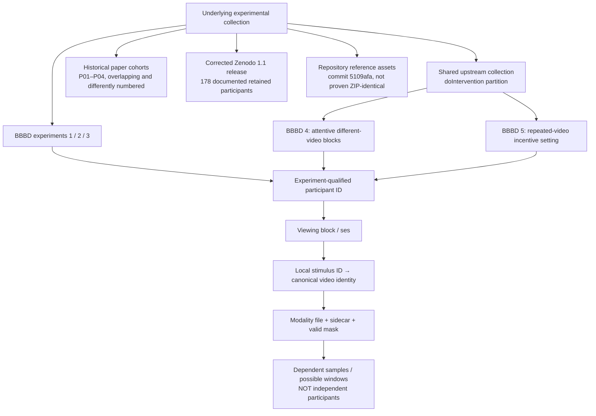

# Which units are nested, and which evidence objects must stay separate?

Sources: S01/S02/S04/S06; P01–P04. The three bottom evidence objects require explicit mappings. A paper's cohort, a reference TSV's distinct IDs and a release's usable signal subjects need not coincide. Unknown cross-experiment repeated participation is not resolved by local IDs.
