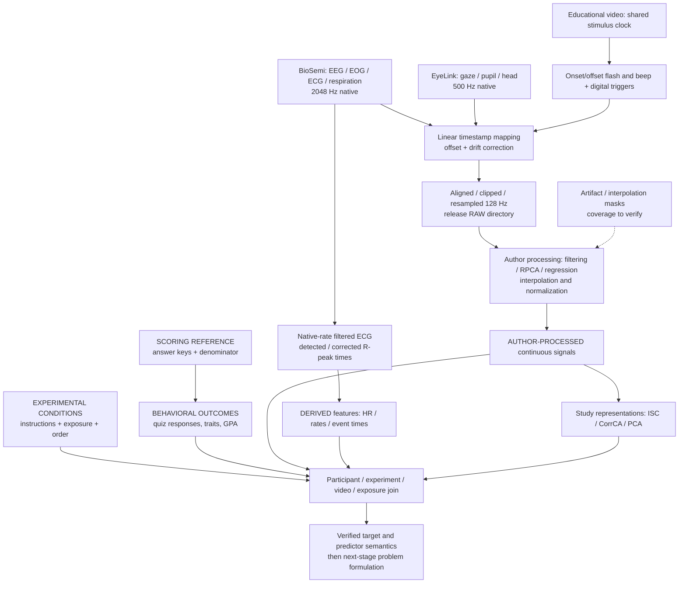

# What survives from acquisition to a valid research target?

Sources: S01 acquisition/preprocessing; S06 pinned code; P01–P04. This is a documented transformation map, not an assertion that native files or every mask are released. Discrete event timestamps do not become raw signals simply because they are precise.

The ordering is conceptual: native peak detection and preprocessing can occur before final resampling. The exported raw signal is not acquisition-original, and no continuous ground-truth attention signal appears in this chain. Residual timing precision, exact derivative options and label joins remain audit gates.
